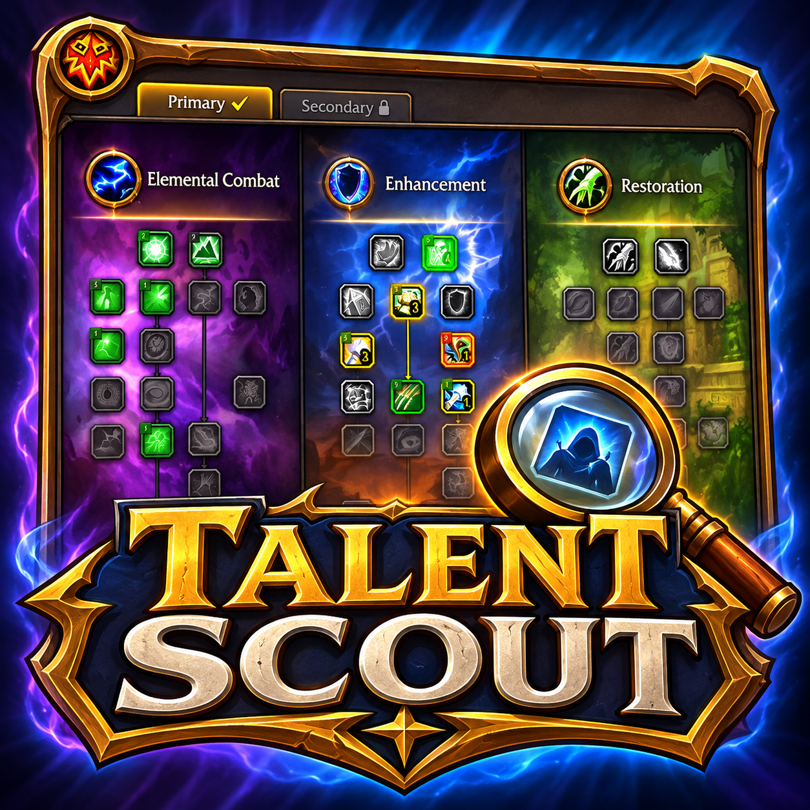

# Talent Scout

A World of Warcraft (WoW Forever) addon that previews talent builds right in your talent window: Damage, Tank or Healer presets, your next recommended point, and your own recorded presets.

## Features
- Left-click a spec icon (e.g. Holy / Protection / Retribution) to preview that tree's preset; click again to hide it
- Right-click a spec icon for all presets: Damage, Tank, Healer, your own, or record a new one
- Preview only: green tint and planned rank on every talent in the preset, nothing is ever spent
- The next recommended talent gets a slowly rotating ring of light
- "Next:" strip shows your next 5 talents in order (hover for the tooltip)
- Follows the arrows: required talents are planned at full rank before the talent they unlock
- Off-preset warning: talents with more points than the preset get a red outline, plus a chat note
- Record your own presets: click talents in order (rows and arrows are enforced like the real game), name it, pick a role, save
- Reminder in chat when you level up with unspent points

Presets are written for WoW Forever's own talent trees. Paladin is done; other classes still use classic-style presets and will be updated.

## Install
Download the latest release zip, put the `TalentScout` folder in `Interface\AddOns`, then `/reload`. Or get it through **Frank's Pack** in WoW Tinker Box.

## Commands
| Command | What it does |
|---|---|
| `/tsc` | Show your next talent and the command list |
| `/tsc list` | List presets for your class |
| `/tsc role dps` / `tank` / `heal` | Preview the first preset for that role |
| `/tsc record` | Record your own preset |
| `/tsc hide` | Preview on/off |
| `/tsc remind` | Level-up reminders on/off |
| `/tsc debug` | Copyable report for bug reports |
| `/tsc dumpall` | Dump every class's talent trees (for writing presets) |
